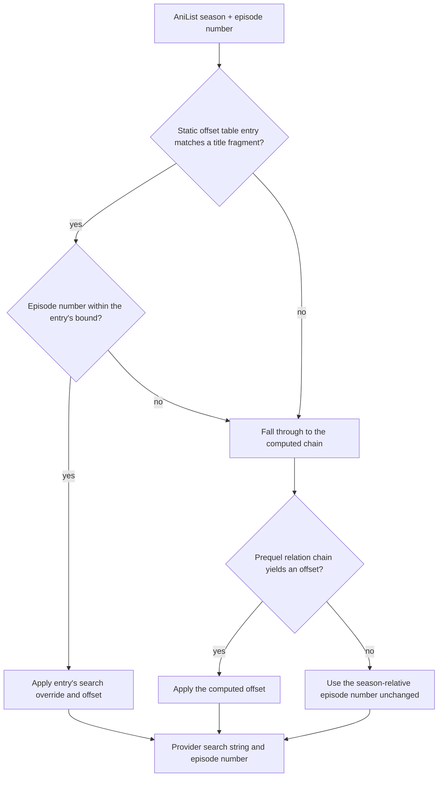

# Design: Attack on Titan Final Season Offset Mapping

## The failure

`resolve_episode_offset(display_part, title_search, anilist_ep, computed_offset)`
returns a `(search, episode)` pair that the caller hands to the provider.
Without a static table entry it falls through to `compute_prequel_offset()`,
which walks AniList's relation graph and sums the episode counts of preceding
seasons.

For *Attack on Titan: The Final Season* that walk is wrong:

```
[00/16] Attack on Titan Final Season        -> ep 60   (expected 1)
[00/12] Attack on Titan Final Season Part 2 -> ep 76   (expected 1)
```

The provider released Part 1 and Part 2 as separate titles, and AniList's
relation graph does not express that split the way the walker expects, so the
walker sums episode counts from seasons that are not actually predecessors of
the requested one. The resulting episode number lands far outside the season.

## The resolution path



## Entry ordering is load-bearing

The table is scanned linearly and the first fragment match wins. The Part 1
fragment is a **substring** of the Part 2 display title:

| display title contains | Part 1 fragment? | Part 2 fragment? |
|---|---|---|
| `Attack on Titan Final Season Part 2` | yes | yes |

If Part 1 were listed first, every Part 2 episode would match the Part 1
entry and be sent to the wrong release with the wrong episode bound. Part 2
entries therefore precede Part 1 entries, so the more specific fragment is
tested first.

## The bounds are load-bearing

Each entry carries the number of episodes in that AniList season:

| AniList season | episodes | provider release |
|---|---|---|
| Final Season Part 1 | 16 | `Attack on Titan: Final Season, Part 1` |
| Final Season Part 2 | 12 | `Attack on Titan: Final Season, Part 2` |

The resolver only applies an entry while `anilist_ep <= max_ep`. Without the
bound, an out-of-range AniList episode would be mapped into a neighbouring
season rather than being left to the computed chain.

## Search overrides are required

The provider titles the releases with a comma: `Attack on Titan: Final
Season, Part 1`. The AniList titles do not contain that string, so an entry
without an override would issue a search the provider cannot answer and fall
back to the season-relative path that produced the bug in the first place.

Three AniList title variants are covered for Part 2 and two for Part 1,
because AniList exposes the series under both the English and the romanised
Japanese title, with and without a separating colon.

## Deliberately not taken: the ruff baseline change

The originating local commit `4dffb2b` also changed
`scripts/ruff_count_baseline.txt` from 16 to 15. The cause is not a lint
fix: the same commit flipped `src/ani_cli_sync/cli.py` from mode 644 to 755,
which silences ruff's `EXE001` ("shebang is present but file is not
executable") as a side effect of making an imported library module
executable.

This change carries no baseline change at all. The underlying `EXE001`
finding was fixed on its own terms in the separate lint-debt change
(`chore/clear-ruff-debt`, PR #96), which removed the vestigial shebang
from a module that is never executed as a script and took the baseline
from 16 to **0**. That fix landed first, so by the time this change is
applied the baseline is already 0 and stays there.

Quietly making a module executable to satisfy a linter would have hidden a
real question behind a green ratchet; the honest fix was to delete the
shebang, and it did not need this change to get there.

## Test strategy

The scenarios in the spec delta become tests in `tests/test_cli.py`:

| scenario | assertion |
|---|---|
| Static table entry resolves the series | Part 1 ep 1 -> (`Attack on Titan: Final Season, Part 1`, 1) |
| Static table entry resolves the series | Part 2 ep 1 -> (`Attack on Titan: Final Season, Part 2`, 1) |
| Longer fragment takes precedence | Part 2 title does not match the Part 1 entry |
| Episode beyond the bound is not remapped | Part 1 ep 17 -> not the Part 1 entry |
| Computed prequel offset remains the fallback | an unlisted series still uses the computed chain |

The computed-offset fallback case is the negative half of the pair: it proves
the table did not swallow the walker's path.
