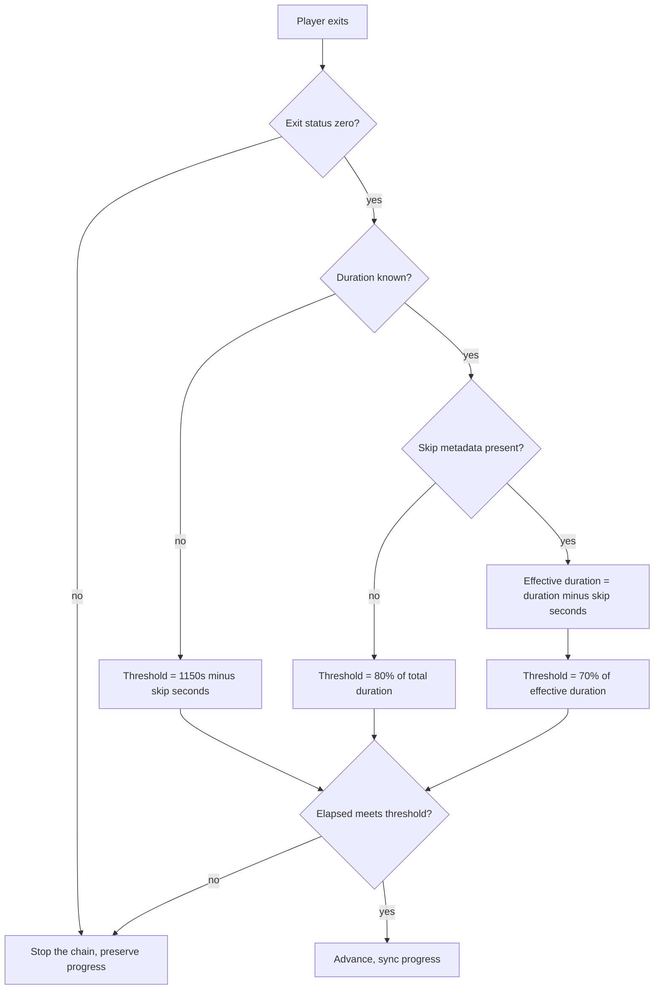

# Design: Specify the Non-Zero Exit Stop Rule

## The decision

One requirement is added to the `autoplay-completion-threshold` capability,
stating that a non-zero player exit stops automated progression regardless of
elapsed time or duration knowledge.

The implementation is unchanged. The design question was therefore not "what
should the code do" but "what does the code already do, and how precisely
does it need to be written down".

## The behaviour being specified

`_should_advance()` evaluates the exit status first, before any duration
reasoning:

The requirement says two things, and the second is the one that is easy to
lose:

1. A non-zero exit stops the chain.
2. The exit status is evaluated **before** the duration threshold is
   computed.

The second clause matters because it fixes an ordering. If the check were
merely "a non-zero exit prevents advancing", a later change could satisfy it
by evaluating the duration first and then discarding the result on a non-zero
exit -- which would be the same observable outcome. Stating the order makes
the requirement assert the implementation's actual shape: the duration is
never computed for an abnormal exit.

## Why the exit code is the right signal

Closing the player window can produce a non-zero exit status, and the
tracker cannot distinguish that from a genuine playback failure. Both are
treated the same way, and that is the correct outcome: neither is positive
evidence that the episode played through.

The alternative -- treating a non-zero exit as neutral and letting the
duration decide -- was the original behaviour and it was wrong. It advanced
to the next episode after the user closed the window, because the elapsed
time was enough to clear a threshold even though the session ended
abnormally.

The general principle is stated in the proposal and is worth repeating here:
**only positive evidence that an episode played through may advance the
chain**. An abnormal exit is the absence of that evidence.

## Requirement length

The requirement text is kept under the 500-character limit that
`openspec validate --strict` enforces, with the scenarios carrying the
detail. An earlier attempt at a single combined requirement was rejected by
the validator for exceeding that limit; splitting the ordering clause out of
the scenario text resolved it.

## Test strategy

No new test. The behaviour is already asserted by two existing tests in
`tests/test_autoplay_stop.py`:

| existing test | assertion | maps to scenario |
|---|---|---|
| `test_nonzero_exit_never_advances` | exit 1 after 60s of a 1440s episode does not advance | abnormal exit during a known-duration episode |
| `test_unknown_duration_nonzero_exit_still_stops` | exit 2 after 1500s with unknown duration does not advance | abnormal exit with an unknown stream duration |

The third scenario (abnormal exit after automated skips) is covered by the
same code path as the first, since the exit check precedes the skip
arithmetic entirely. It is written into the spec because the skip regime is
the one where a relaxed threshold makes an accidental advance most plausible,
so the guarantee is worth stating explicitly there.

The existing tests were confirmed to pass against the current implementation
before this change was written, so the spec describes verified behaviour
rather than intended behaviour.
