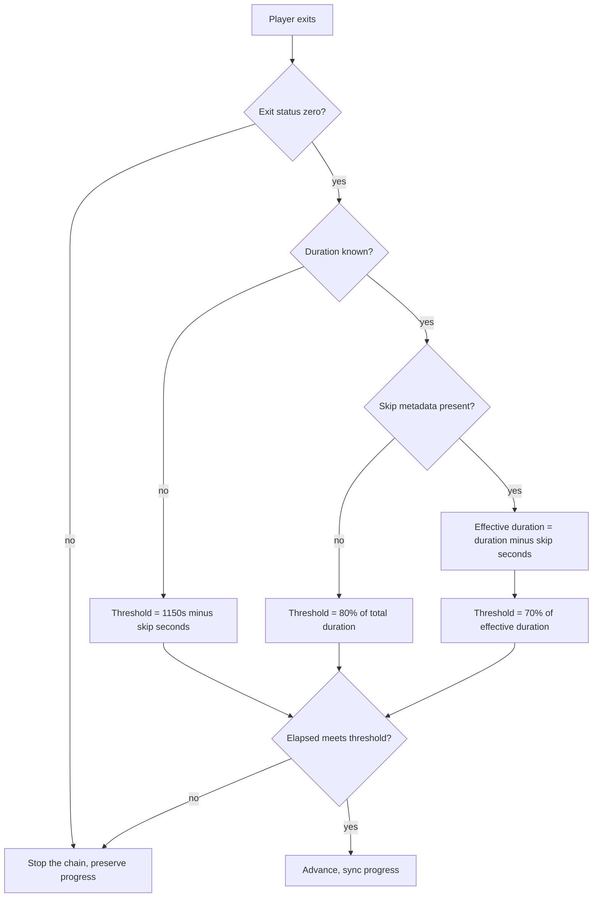

# Design: Specify the Non-Zero Exit Stop Rule

## The decision

One requirement is added to the `autoplay-completion-threshold` capability,
stating that a non-zero player exit stops automated progression regardless of
elapsed time or duration knowledge.

The implementation is unchanged. The design question was therefore not "what
should the code do" but "what does the code already do, and how precisely
does it need to be written down".

## The behaviour being specified

`_should_advance()` evaluates the exit status first, before any duration
reasoning:

The requirement says two things, and the second is the one that is easy to
lose:

1. A non-zero exit stops the chain.
2. The abnormal exit is reported as the cause of the stop.

The second clause is what distinguishes an abnormal session from one the user
ended early, and it is observable: the reason is printed to the user as
"Playback stopped (..., {why})".

### Why the requirement does not fix an ordering

An earlier draft of this requirement said the exit status "SHALL be evaluated
before any duration-based threshold is computed". That was dropped, and not
for stylistic reasons.

The draft's rationale was that a later change could satisfy the requirement by
computing the duration first and then discarding the result on a non-zero
exit -- the same observable outcome, reached by a different internal order.
But "the duration is never computed for an abnormal exit" is not observable.
Nothing the user sees distinguishes a tracker that computed a threshold and
threw it away from one that never computed it.

A sensitivity probe settled it. Three mutations were applied to
`_should_advance()` in turn, and the test suite re-run each time:

| mutation | what changed | suite result |
|---|---|---|
| A | the exit check removed entirely | 5 failures, including all three tests added by this change |
| B | the exit check moved after the duration block, but still before the advance decision | **18 passed -- the mutation was invisible** |
| C | the exit check moved after the advance decision | 3 failures, including the two new progression tests |

Mutation B is the case the old clause was written to forbid, and no test
caught it. Mutation C is the case that actually matters -- a non-zero exit
that nevertheless advances -- and it is caught.

So the requirement now states the observable that mutation C violates: the
chain stops, and the reported cause is the abnormal exit. That wording
constrains the real defect while saying nothing about internal ordering.

## Why the exit code is the right signal

Closing the player window can produce a non-zero exit status, and the
tracker cannot distinguish that from a genuine playback failure. Both are
treated the same way, and that is the correct outcome: neither is positive
evidence that the episode played through.

The alternative -- treating a non-zero exit as neutral and letting the
duration decide -- was the original behaviour and it was wrong. It advanced
to the next episode after the user closed the window, because the elapsed
time was enough to clear a threshold even though the session ended
abnormally.

The general principle is stated in the proposal and is worth repeating here:
**only positive evidence that an episode played through may advance the
chain**. An abnormal exit is the absence of that evidence.

## Requirement length

The requirement text is kept under the 500-character limit that
`openspec validate --strict` enforces, with the scenarios carrying the
detail. An earlier attempt at a single combined requirement was rejected by
the validator for exceeding that limit; splitting the ordering clause out of
the scenario text resolved it.

## Test strategy

Three tests were added to `tests/test_autoplay_stop.py`, one per spec
scenario, so that each scenario is asserted directly rather than inferred
from a neighbouring case:

| test | assertion | maps to scenario |
|---|---|---|
| `test_nonzero_exit_never_advances` (existing) | exit 1 after 60s of a 1440s episode does not advance | abnormal exit, short of the threshold |
| `test_nonzero_exit_after_full_duration_does_not_advance` (new) | exit 1 after 1440s of a 1440s episode does not advance | abnormal exit during a known-duration episode |
| `test_unknown_duration_nonzero_exit_still_stops` (existing) | exit 2 after 1500s with unknown duration does not advance | abnormal exit with an unknown stream duration |
| `test_nonzero_exit_after_skips_does_not_advance` (new) | exit 1 after 1308s of a 1463s episode with 176s skipped does not advance | abnormal exit after automated skips |
| `test_abnormal_exit_reason_names_the_exit_not_the_duration` (new) | the stop reason names the exit, and the early-quit case still names the duration | the reported-cause clause |

The two new progression tests matter because the two pre-existing tests
exercise the exit check at a point where a duration rule would also have
stopped the chain. A full-length non-zero exit and a skip-regime non-zero
exit both clear every threshold on elapsed time alone, so only the exit status
can stop them. Without these tests, removing the exit check would still have
been caught -- but only by the short-duration cases, and the spec's two
consequential scenarios would have had no direct assertion.

`test_abnormal_exit_reason_names_the_exit_not_the_duration` ships as a
positive/negative pair: the abnormal exit reports the exit, and a normal
early quit still reports the duration. That pair is what pins the
"reported cause" clause to an observable.

The sensitivity probe results are in the "Why the requirement does not fix an
ordering" section above: mutation A fails 5 tests, mutation B is invisible,
mutation C fails 3.
