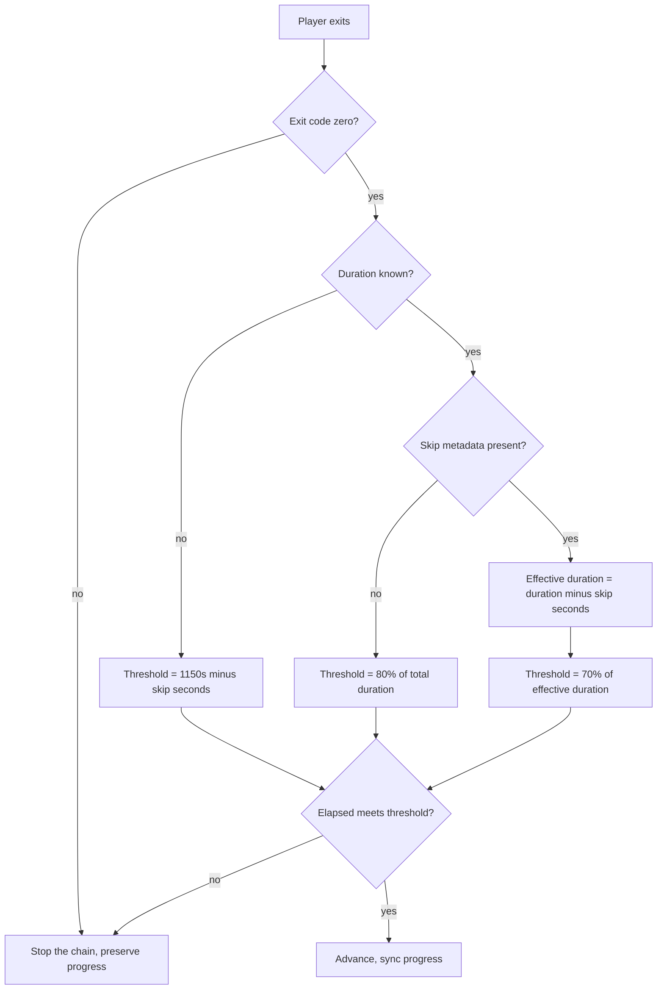

# Design: Skip-Aware Autoplay Completion Ratio

## The decision

`_should_advance()` computes a completion threshold and compares the elapsed
wall-clock playback time against it.

Two ratios, two regimes:

| regime | threshold | rationale |
|---|---|---|
| skip metadata known | 70% of effective duration | the tracker knows non-narrative content was skipped, so the floor is relaxed |
| skip metadata unknown | 80% of total duration | the user may have skipped manually, so a stricter floor applies |

Only the first regime changes.

## Why 70% and not 85%

The failing case is Attack on Titan S1 episode 15: 1463s duration, 176s
skipped, 1028s elapsed.

| ratio | effective duration | threshold | 1028s elapsed |
|---|---|---|---|
| 85% (current) | 1287s | 1094s | below -> stops |
| 70% (new) | 1287s | 901s | above -> advances |

The 15-point band between the two thresholds is where recaps, credits and
post-ED segments sit on the affected releases. The episode had played its
narrative content; the tracker was measuring against a floor that assumed
skip metadata accounted for all non-narrative runtime, which it did not.

70% is chosen rather than a rounder lower bound because it is the value the
original local commit used, and it is above every early-quit observation
recorded in the test suite.

## What is deliberately not relaxed

The early-quit protection is the reason the threshold exists. Lowering the
skip-aware ratio must not make a closed player window look like a completed
episode.

The recorded early-quit case is 600s elapsed of a 1463s episode with 177s
skipped. Against the new 70% threshold the required time is 900s, so 600s is
still far below it and still stops. The gap between the earliest legitimate
advance (1028s) and the recorded early quit (600s) remains wide.

The no-skip regime is untouched: 80% of the total duration. A user who
manually skipped the OP and ED without metadata gets no credit for it, which
is the conservative behaviour and is not part of the reported failure.

The unknown-duration fallback is untouched: it is an absolute second count
(1150s) minus skips, not a ratio, so it cannot be expressed as a ratio change.

## Test strategy

The spec delta scenarios become tests in `tests/test_autoplay_stop.py`:

| scenario | assertion |
|---|---|
| Skipped episode at 1028s of 1463s with 176s skipped | advances |
| Skipped episode at 600s of 1463s with 177s skipped | stops, progress preserved |
| No-skip episode at 1008s of 1440s | stops (80% baseline unchanged) |
| No-skip episode at 1152s of 1440s | advances (80% baseline unchanged) |

The third and fourth scenarios are the negative and positive halves of the
pair that pins the no-skip regime: they prove the ratio change did not leak
into the branch that must not move.
