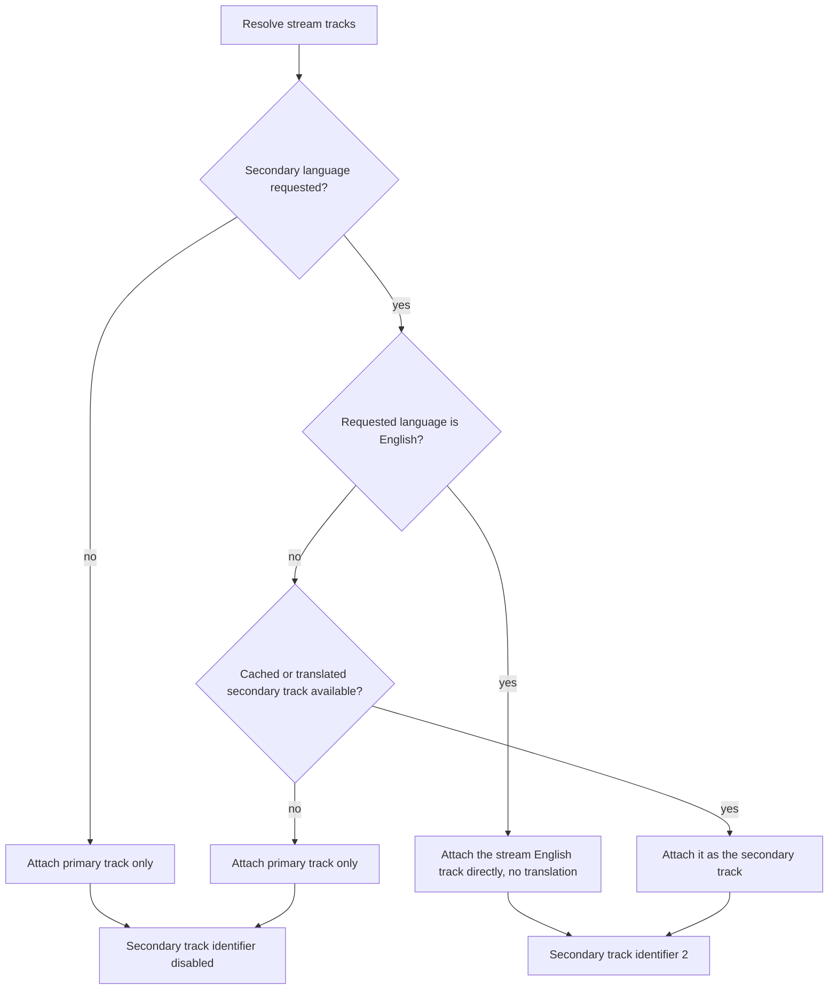

# Design: Secondary Subtitle Disabled By Default

## The current behaviour

`prepare_subtitles()` builds the list of subtitle files the player will load.
It resolves a primary track (a cached file, a German stream track, or a
translated track) and then, separately, appends whatever secondary material it
has.

The current tail of that logic is:

```python
if secondary_file:
    sub_files.append(secondary_file)
elif stream_en_url and stream_en_url not in sub_files:
    sub_files.append(stream_en_url)

if len(sub_files) < 2:
    secondary_sid = 0
```

The `elif` branch is the problem. It fires when no secondary track was
produced, which is the *default* case, and it appends the stream's English
track anyway.

## The decision

The English fallback track is attached only when the user asked for a
secondary track.



Two decisions follow from this, and they are separable.

**1. The fallback becomes conditional.** The `elif stream_en_url` branch moves
inside the "a secondary language was requested" case. When nothing was
requested, the plan holds the primary track alone.

**2. English is not translated.** When the requested secondary language is
English and the stream carries an English track, that track is attached
directly. The alternative - translating English into English - would consume a
model call and produce a track that is not better than the one already on the
stream. This was a latent inefficiency in the original code, where the
secondary translation path was guarded only by "a secondary file is missing",
not by "the requested language differs from the source language".

## Why the track is dropped rather than kept inactive

The alternative to omitting the English track was to keep it in the plan with
the secondary identifier disabled. That would leave the track available for
manual toggling in the player, at the cost of one extra network fetch for a
remote WebVTT file that most viewers will never open.

The trade-off was decided in favour of omission: the plan should describe what
will actually be shown, and a fetch that loads a subtitle nobody reads is a
request the player did not need to make. The capability itself is not lost -
requesting English explicitly attaches the same track.

## The disabled-state fallback

If a secondary language was requested but no track could be produced for it
(no cache entry, no translation), the plan falls back to the primary track
alone and the secondary identifier stays disabled. A missing secondary track
must never leave the player pointing at a track index that does not exist.

## The primary-track fallback, and one behaviour it repairs

The stream's English track is the primary when no German track is available.
Before this change the English track reached the plan through the *secondary*
branch, so it only arrived when the secondary branch fired. Moving it into the
primary chain makes the fallback explicit and independent of whether a
secondary was requested.

That moves one observable case. When the German translation fails and a
secondary language was requested, the old code produced a plan whose only
track was the requested secondary, at `sid=1`, with `secondary_sid=0`. The
requested secondary had silently become the primary, and the English fallback
was absent. Measured on this change:

| case | old plan | new plan |
|---|---|---|
| no secondary requested, German fails | English at `sid=1` | English at `sid=1` (unchanged) |
| secondary `en` requested, German fails | translated English at `sid=1` | English at `sid=1`, no translation call |
| secondary `zh-pinyin` requested, German fails | `zh-pinyin` at `sid=1` | English at `sid=1`, `zh-pinyin` at `sid=2` |

The third row is a repair, not a regression: the old plan pointed the primary
index at the requested secondary track, which is the opposite of what a
secondary track is for. The new plan keeps the English fallback as the primary
and puts the requested track where the player expects it.

Both edge cases are pinned by tests, so the difference is recorded rather than
merely asserted in prose.

## Test strategy

The spec delta scenarios become tests in `tests/test_subtitles.py`:

| scenario | assertion |
|---|---|
| Default playback with an English track on the stream | one subtitle file, secondary identifier 0 |
| Secondary requested as English | two subtitle files, the stream English track second, secondary identifier 2, no translation call |
| Secondary requested in another language | the translated track is second, secondary identifier 2 |
| Secondary requested but not producible | one subtitle file, secondary identifier 0 |
| German primary failed, no secondary requested | the English track is the primary at index 0 |
| German primary failed, secondary requested | English at index 0, requested secondary at index 1, secondary identifier 2 |

The "no translation call" assertion in the second row is the pair that pins
decision 2. Without it, a regression that reintroduced the English
round-trip would still produce a correct-looking plan.

The fourth row is the negative half of the pair for the disabled-state
fallback: it proves that a failed secondary request does not leave the player
pointing at a non-existent track index.

The last two rows pin the primary-track fallback described above. They exist
because that path is the one the old code got wrong.
